# 웹툰 처리 디자인 패턴 관계도

복잡한 메서드와 내부 보조 타입은 빼고, 패턴을 이루는 핵심 클래스·인터페이스·객체 관계만 표시했다.

표기법: 점선 삼각형은 `implements`, 실선 삼각형은 `extends`, 일반 화살표는 `uses/next`, 마름모는 `contains/wraps` 관계다.

## Task1 — 여백을 기준으로 컷 분할

| 패턴 | 핵심 구조 관계 | 이 구조를 사용한 이유 |
|---|---|---|
| Strategy | `StrategySplitter`가 `RowClassifier` 인터페이스에 행 판정을 위임하고 세 분류기가 이를 구현한다. | 컷 분할 흐름은 유지하면서 배경색 판정 알고리즘만 실행 중에도 교체하기 위해서다. |
| Template Method | `AbstractWebtoonSplitter`가 처리 순서를 고정하고 `RgbMarginTemplateSplitter`가 컷 탐색 단계만 구현한다. | 로딩 → 탐색 → 저장 순서의 중복과 실수를 막고 변화 지점만 하위 클래스에 열기 위해서다. |
| Chain of Responsibility | `BlankZoneHandler`를 상속한 검사 객체들이 `next`로 연결되고 `ChainCutPointDetector`가 첫 Handler를 사용한다. | 여백 후보의 높이·색 안정성·절단 안전성 검사를 독립적으로 추가하거나 순서를 바꾸기 위해서다. |
| Decorator | 기본 `RgbMarginCutPointDetector`와 Decorator들이 모두 `CutPointDetector`를 구현하며, Decorator는 같은 인터페이스 객체를 감싼다. | 원본 탐색기를 수정하지 않고 검증과 시간 측정을 선택적으로 조합하기 위해서다. |
| Proxy | `CachingImageRepositoryProxy`와 `DiskImageRepository`가 같은 `ImageRepository`를 구현하고 Proxy가 실제 저장소를 감싼다. | 서비스 코드를 바꾸지 않은 채 반복 이미지 로딩에 캐시를 적용하기 위해서다. |
| Abstract Factory | 두 Factory가 `ProcessingFamilyFactory`를 구현하고 로더·탐색기·저장기 제품군을 함께 생성한다. | 표준 구성과 캐시 구성을 서로 맞는 객체 묶음으로 한 번에 교체하기 위해서다. |
| Composite + Visitor | Batch와 Episode는 자식을 포함하는 Composite, Page는 Leaf이며 모두 `WebtoonElement`를 구현한다. `SplitPageVisitor`는 별도 방문 연산이다. | 웹툰의 계층 구조와 컷 분할 로직을 분리해 새 작업을 Visitor로 추가하기 위해서다. |

### 1. Strategy

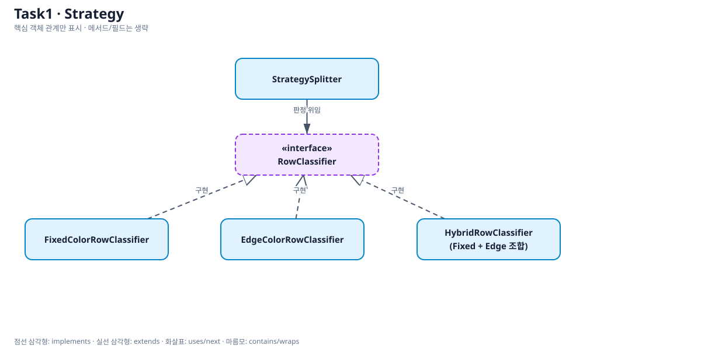

행을 여백으로 판정하는 알고리즘을 `RowClassifier`로 교체한다.

### 2. Template Method

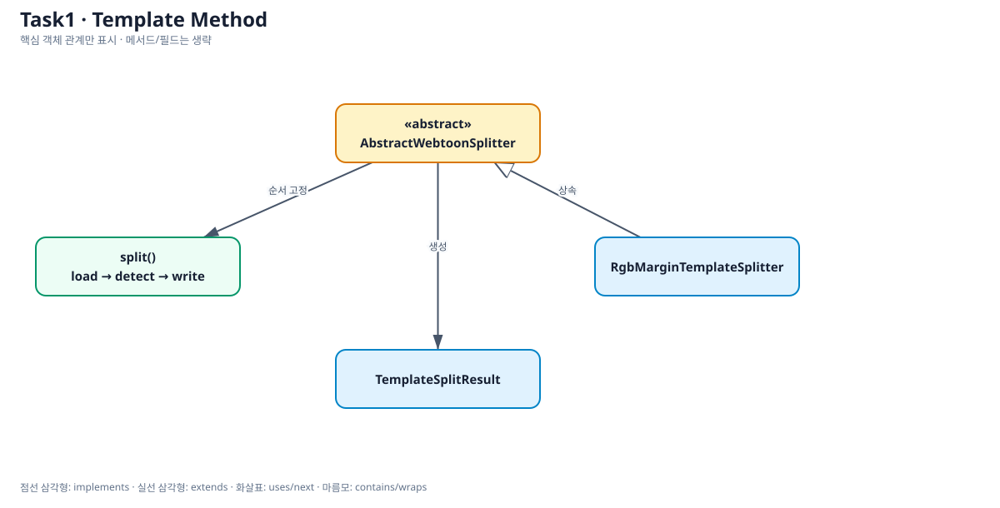

로딩 → 컷 탐색 → 저장 순서는 부모가 고정하고 RGB 탐색만 자식이 구현한다.

### 3. Chain of Responsibility

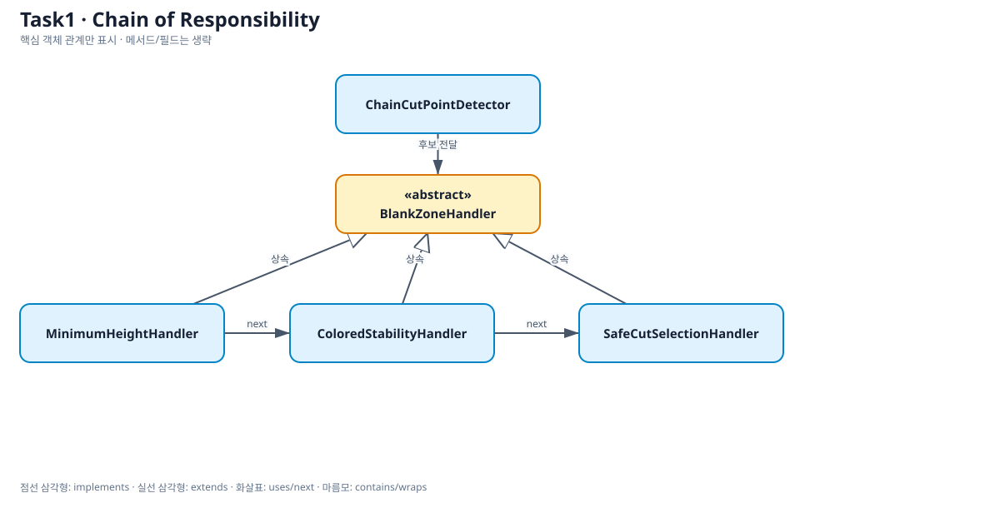

여백 후보가 최소 높이, 색 안정성, 안전한 절단 위치 검사를 차례로 통과한다.

### 4. Decorator

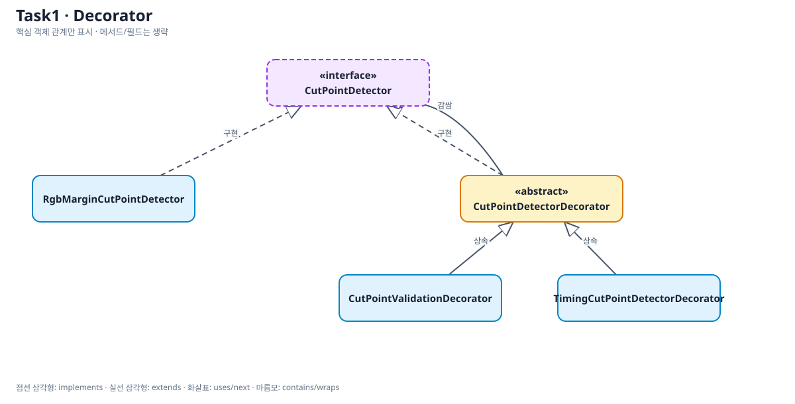

기본 탐색기를 바꾸지 않고 결과 검증과 시간 측정을 겹쳐 감싼다.

### 5. Proxy

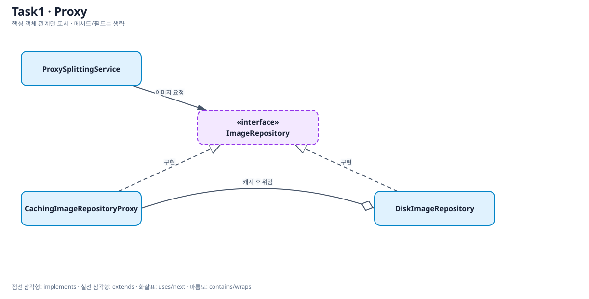

서비스는 동일한 저장소 인터페이스를 사용하고 Proxy가 디스크 로딩 결과를 캐시한다.

### 6. Abstract Factory

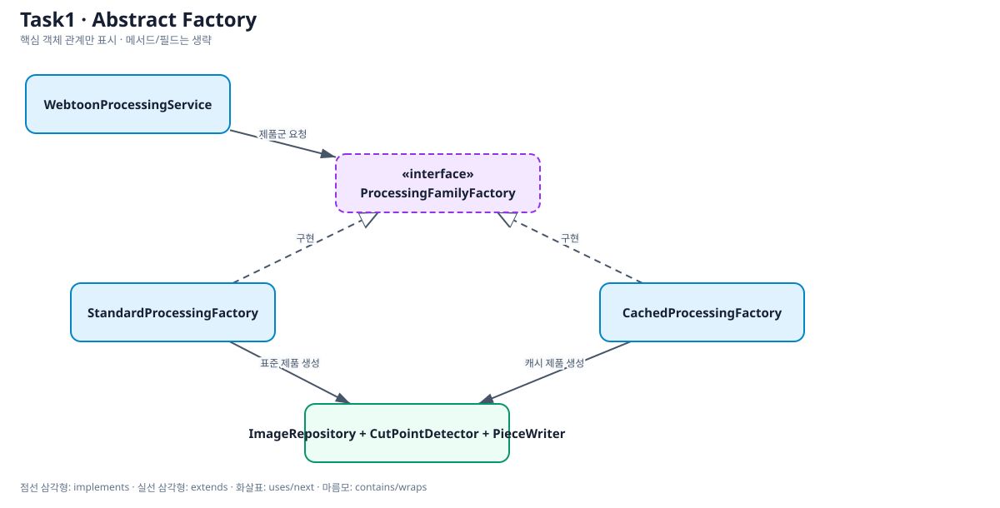

서로 호환되는 로더·탐색기·저장기를 하나의 제품군으로 생성한다.

### 7. Composite + Visitor

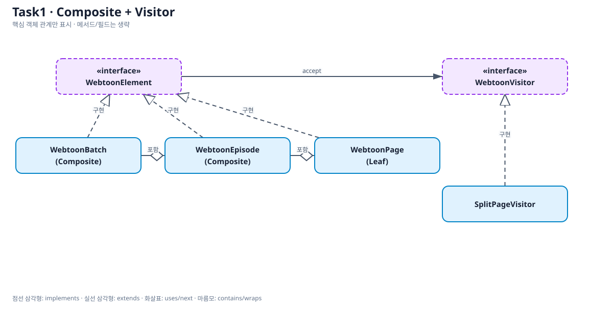

배치 → 에피소드 → 페이지 계층을 Visitor가 순회하며 각 페이지를 분할한다.

## Task2 — 여백을 버리고 실제 그림 영역만 추출

Task2의 모든 구현은 `ContentRegion(top, bottomExclusive)` 목록을 계산하고, 그 영역만 JPEG로 저장한다. 핵심 알고리즘은 위·아래 바깥 여백과 중간의 안전한 여백 구간을 제거하되 말풍선·글자·선을 콘텐츠로 보호한다.

### 1. Strategy

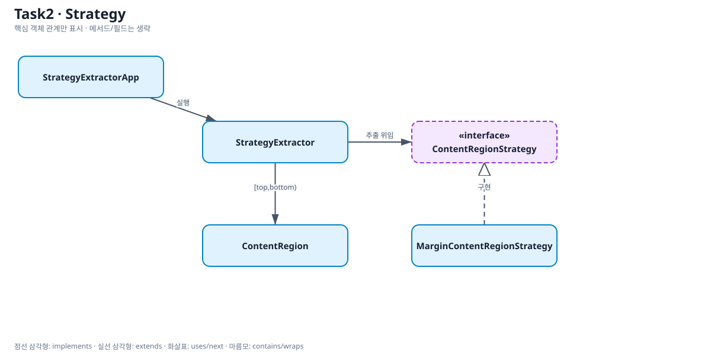

### 2. Template Method

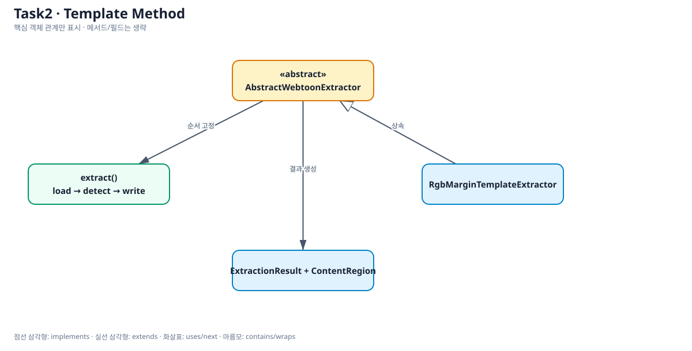

### 3. Chain of Responsibility

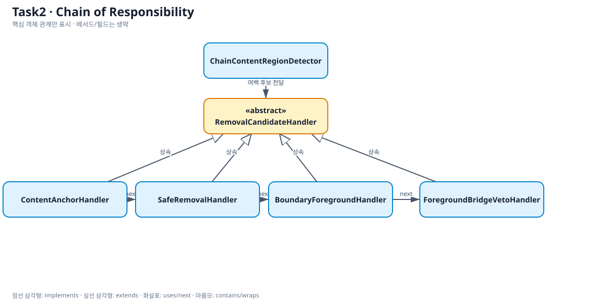

### 4. Decorator

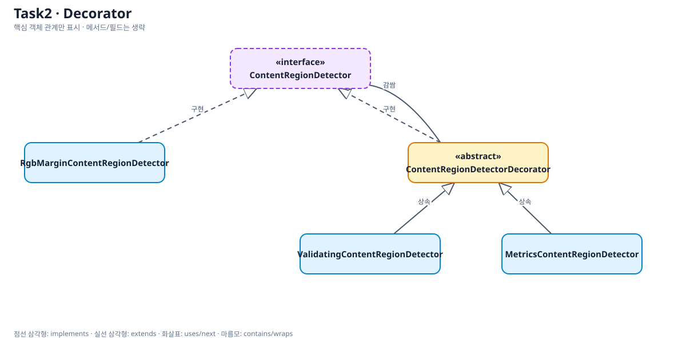

### 5. Proxy

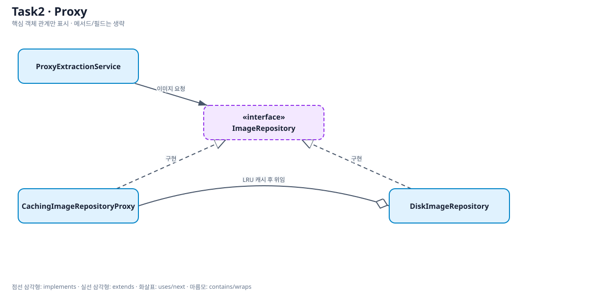

### 6. Abstract Factory

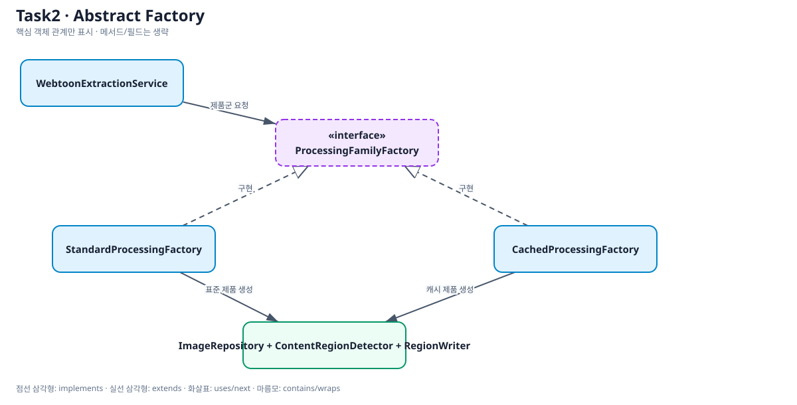

### 7. Composite + Visitor

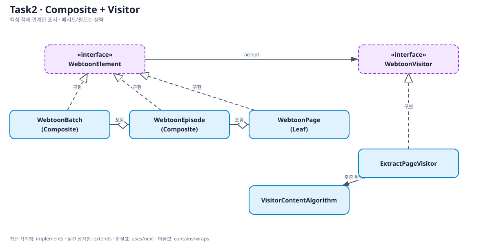

## 코드 위치

| 패턴 | Task1 | Task2 |
|---|---|---|
| Strategy | `task1/strategy` | `task2/variants/strategy` |
| Template Method | `task1/template` | `task2/variants/template` |
| Chain of Responsibility | `task1/chain` | `task2/variants/chain` |
| Decorator | `task1/decorator` | `task2/variants/decorator` |
| Proxy | `task1/proxy` | `task2/variants/proxy` |
| Abstract Factory | `task1/factory` | `task2/variants/factory` |
| Composite + Visitor | `task1/visitor` | `task2/variants/visitor` |

SVG를 다시 만들려면 저장소 루트에서 `node docs/diagrams/generate-diagrams.js`를 실행한다.
