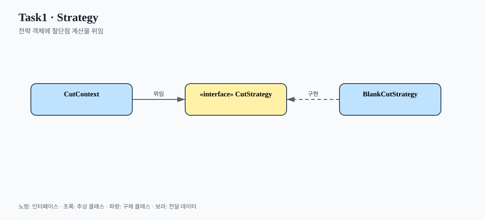
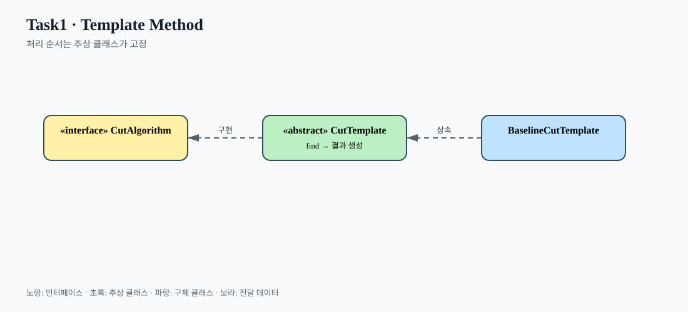
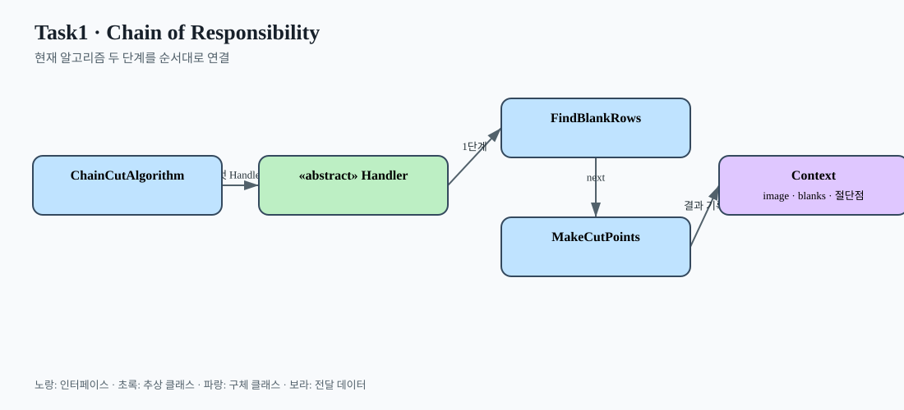
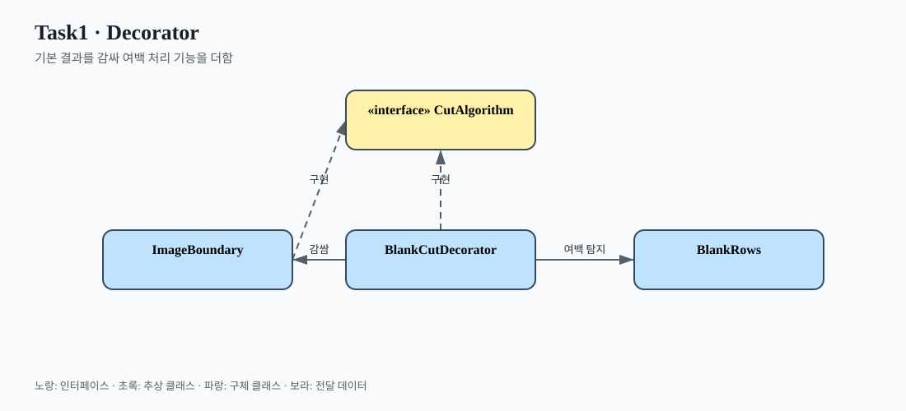
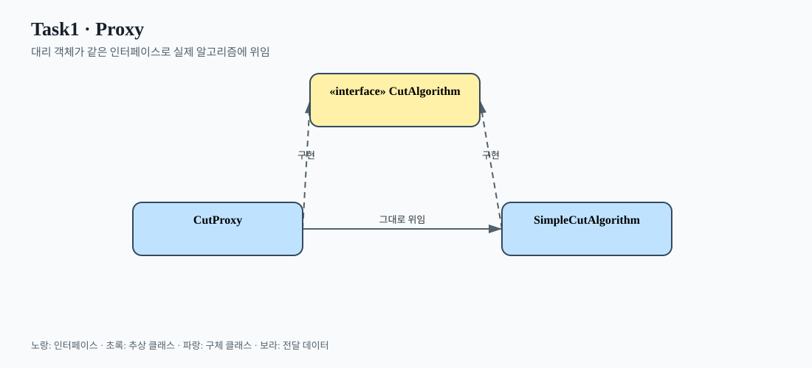
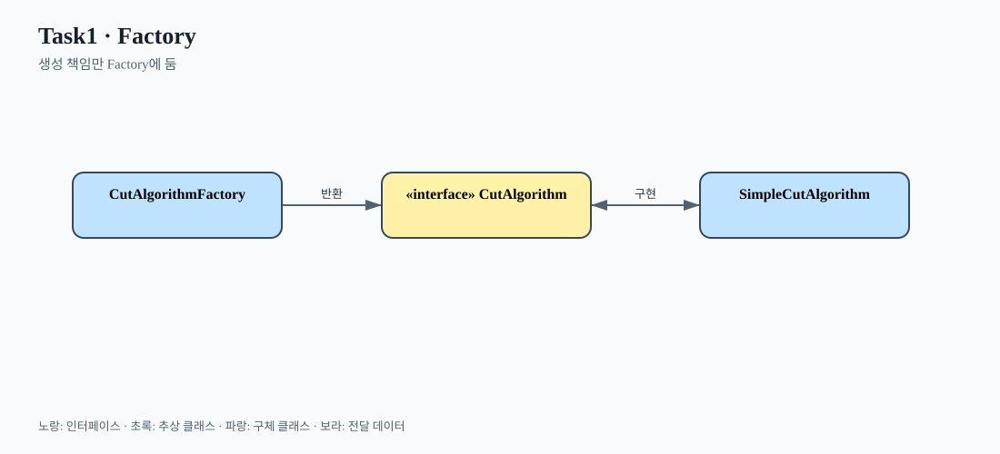
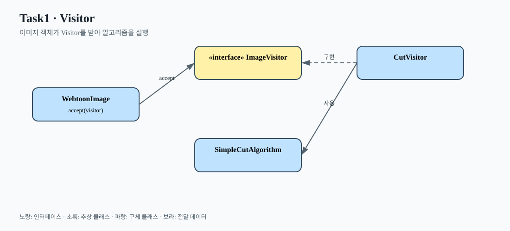

# Task1: 여백 가운데에서 웹툰 자르기

## 실제 코드 흐름

```text
Task1Runner
  → CutAlgorithm.detectCuts(image)
  → BlankRows.find(image, 50)
  → Cuts.from(height, blankRuns)
  → ImageFiles.savePart(...)
```

- `core/SimpleCutAlgorithm.java`: 여백 탐지와 절단점 생성을 연결하는 핵심 알고리즘
- `../webtoon/core/BlankRows.java`: 각 행을 한 번씩 훑어 50px 이상 연속 여백을 찾음
- `core/Cuts.java`: 이미지 시작, 여백의 가운데, 이미지 끝을 절단점으로 확정
- `core/Task1Runner.java`: 이미지를 읽고 절단점 사이를 잘라 저장

## 일곱 패턴

### Strategy



알고리즘을 `CutStrategy` 객체로 분리하고 `CutContext`가 호출하는 패턴이다. 이 코드에서는
여백 기반 계산의 담당 객체가 명확해진다는 점이 주된 이유이자 이점이며, 계산 자체는 바뀌지 않는다.

코드: `strategy/StrategyExample.java`

### Template Method



추상 클래스가 `여백 탐지 → 절단점 생성` 순서를 고정하고 하위 클래스가 두 단계를 구현한다.
처리 순서를 한 메서드에서 바로 읽을 수 있고, 단계가 뒤바뀌지 않는 것이 이점이다.

코드: `template/TemplateMethodExample.java`

### Chain of Responsibility



`FindBlankRows → MakeCutPoints` 두 Handler가 Context를 차례로 처리한다. 여기서는 검사를
통과해야 다음으로 가는 구조가 아니라, 앞 단계가 값을 만든 뒤 다음 단계가 그 값을 쓰는 순차 파이프라인이다.

코드: `chain/ChainExample.java`

### Decorator



기본 `ImageBoundary` 결과 `[0, 높이]`를 `BlankCutDecorator`가 감싸 여백 가운데 절단점을
추가한다. 이미지 경계와 여백 절단이라는 현재의 두 책임이 작은 객체로 구분되는 것이 이점이다.

코드: `decorator/DecoratorExample.java`

### Proxy



`CutProxy`가 `CutAlgorithm`과 같은 인터페이스를 구현하고 실제 알고리즘에 그대로 위임한다.
호출자가 실제 클래스 대신 대리 객체를 사용하게 하는 구조를 보여줄 뿐, 캐시나 속도 향상은 없다.

코드: `proxy/ProxyExample.java`

### Factory



`CutAlgorithmFactory`가 `SimpleCutAlgorithm` 생성만 담당하고 호출자에게 인터페이스로 반환한다.
알고리즘 실행 코드와 `new`로 객체를 만드는 위치가 분리되어 생성 위치를 찾기 쉬운 것이 이점이다.

코드: `factory/FactoryExample.java`

### Visitor



`WebtoonImage.accept(visitor)`가 `CutVisitor`를 받아 절단 계산을 실행한다. 이미지 데이터와
이미지에 수행하는 동작을 나눠 표현하는 패턴이며, 픽셀은 기존 알고리즘과 똑같이 한 번 탐색한다.

코드: `visitor/VisitorExample.java`
