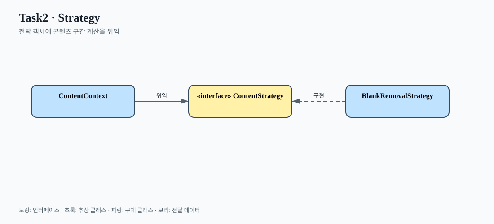
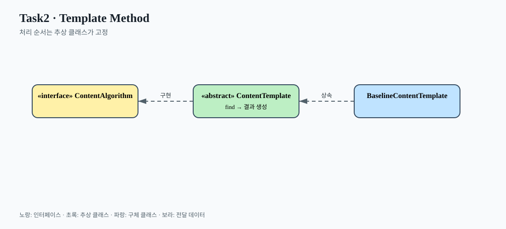
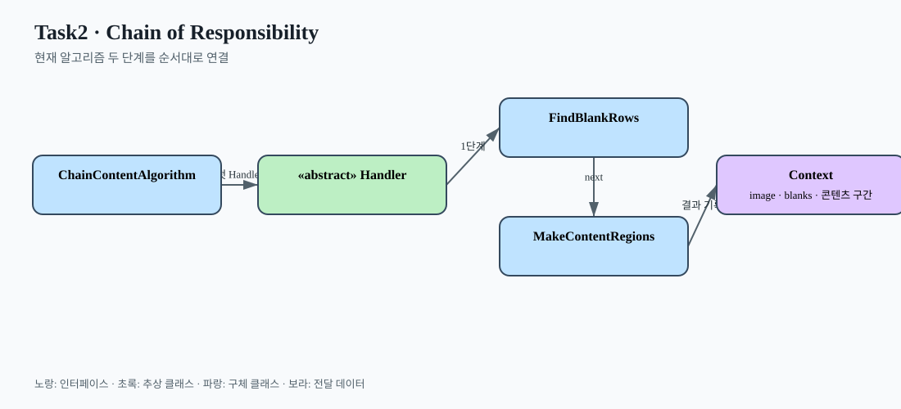
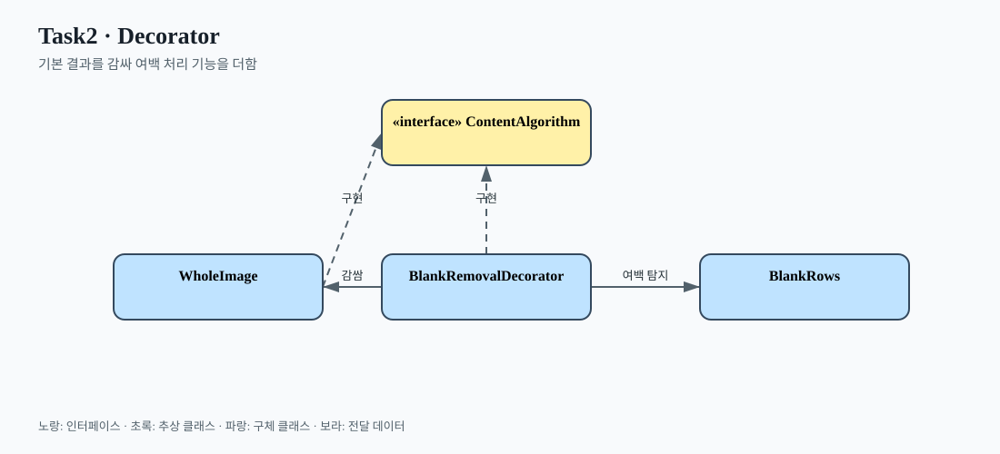
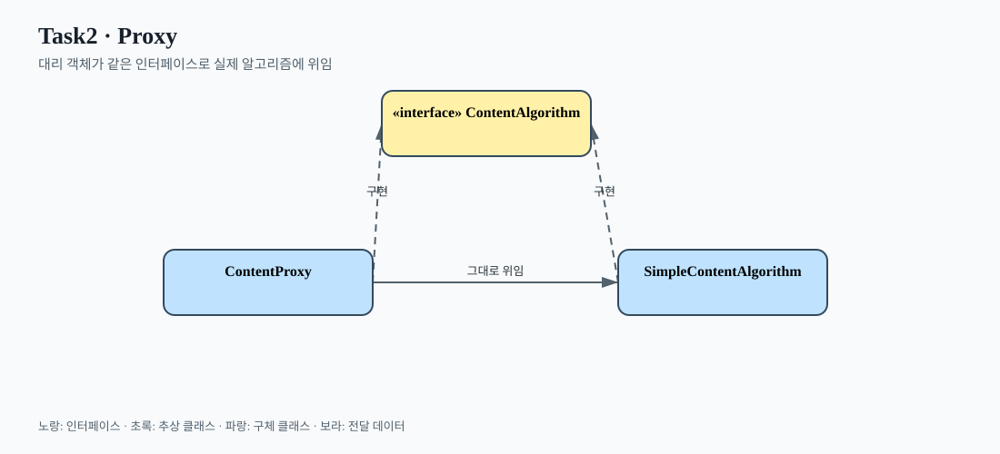
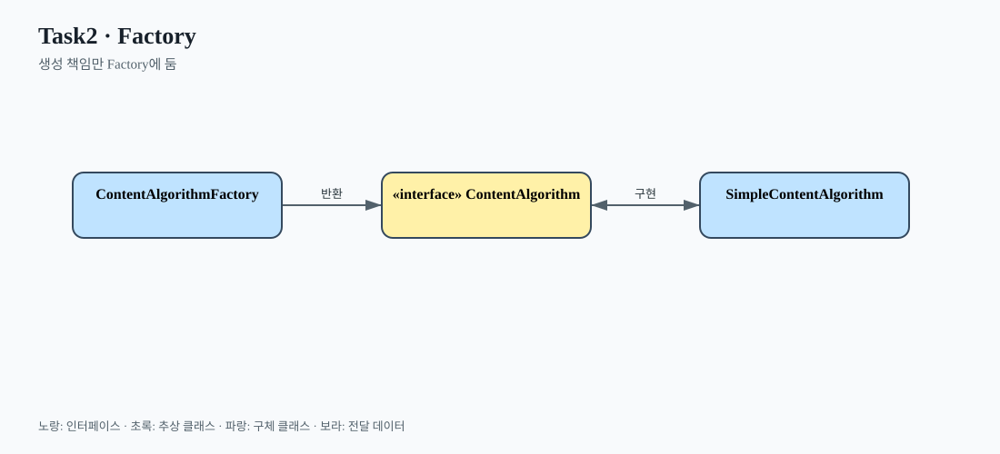
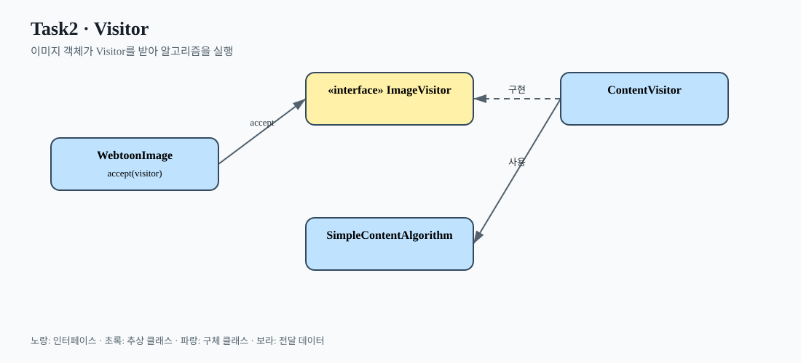

# Task2: 여백을 제외하고 그림 구간만 추출하기

## 실제 코드 흐름

```text
Task2Runner
  → ContentAlgorithm.detectContent(image)
  → BlankRows.find(image, 48)
  → Regions.withoutBlank(height, blankRuns)
  → ImageFiles.savePart(...)
```

- `core/SimpleContentAlgorithm.java`: 여백 탐지와 콘텐츠 구간 생성을 연결
- `../webtoon/core/BlankRows.java`: 각 행을 한 번씩 훑어 연속 여백을 찾음
- `core/Regions.java`: 여백을 빼고 남은 좌표만 `ContentRegion`으로 확정
- `core/Task2Runner.java`: 콘텐츠 좌표만 잘라 저장

## 일곱 패턴

### Strategy



`ContentContext`가 콘텐츠 계산을 `ContentStrategy`에 위임한다. 여백 제거 계산을 맡은 객체가
분명하게 보이는 것이 적용 이유와 이점이며, 파일 읽기나 저장 방식은 전략에 포함하지 않았다.

코드: `strategy/StrategyExample.java`

### Template Method



추상 클래스가 `여백 탐지 → 여백 제외` 순서를 고정하고 구체 클래스가 각 단계를 구현한다.
Task2의 핵심 순서가 한 메서드에 드러나며, 두 단계의 역할이 섞이지 않는다.

코드: `template/TemplateMethodExample.java`

### Chain of Responsibility



`FindBlankRows`가 여백 좌표를 Context에 넣고 `MakeContentRegions`가 남은 구간을 만든다.
통과 여부를 검사하는 체인이 아니라, 현재 알고리즘의 두 순차 작업을 연결한 체인이다.

코드: `chain/ChainExample.java`

### Decorator



기본 `WholeImage` 결과를 `BlankRemovalDecorator`가 감싸 긴 여백을 제외한다. 전체 이미지라는
기본 결과와 여백 제거라는 현재 기능을 겹쳐 구성한 모습이 코드에 직접 드러난다.

코드: `decorator/DecoratorExample.java`

### Proxy



`ContentProxy`가 실제 `SimpleContentAlgorithm` 호출을 대신 전달한다. 대리 객체의 형태만
보여주는 최소 구현이며, 캐시·지연 로딩·운영체제 최적화는 전혀 없다.

코드: `proxy/ProxyExample.java`

### Factory



`ContentAlgorithmFactory`가 현재 사용하는 알고리즘 객체를 만들어 인터페이스로 반환한다.
객체 생성과 콘텐츠 계산을 분리해 어느 코드가 무엇을 책임지는지 바로 알 수 있다.

코드: `factory/FactoryExample.java`

### Visitor



`WebtoonImage`가 `ContentVisitor`를 받아 콘텐츠 구간 계산을 실행한다. 데이터와 수행 동작을
분리해 보여주는 학습 구조이고, 반복 방문이나 추가 픽셀 스캔은 만들지 않았다.

코드: `visitor/VisitorExample.java`
